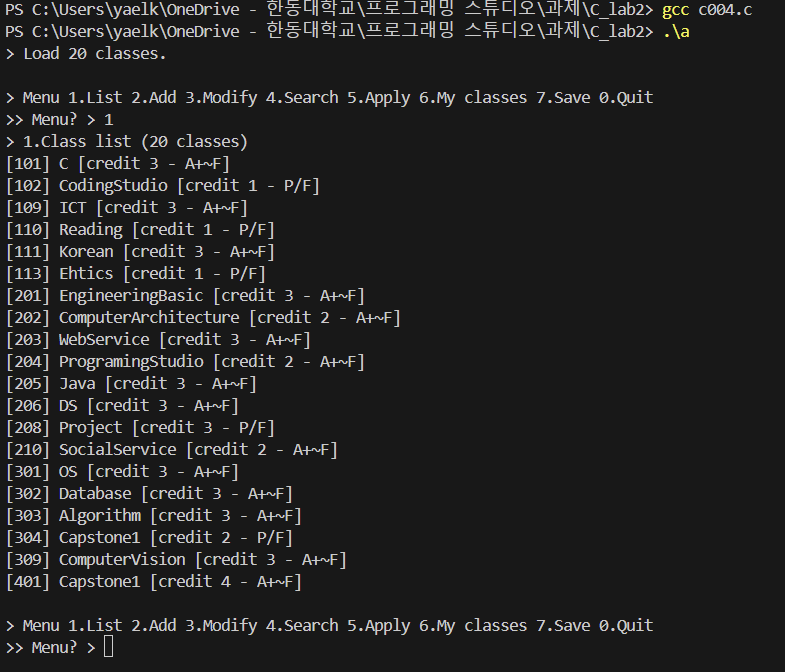
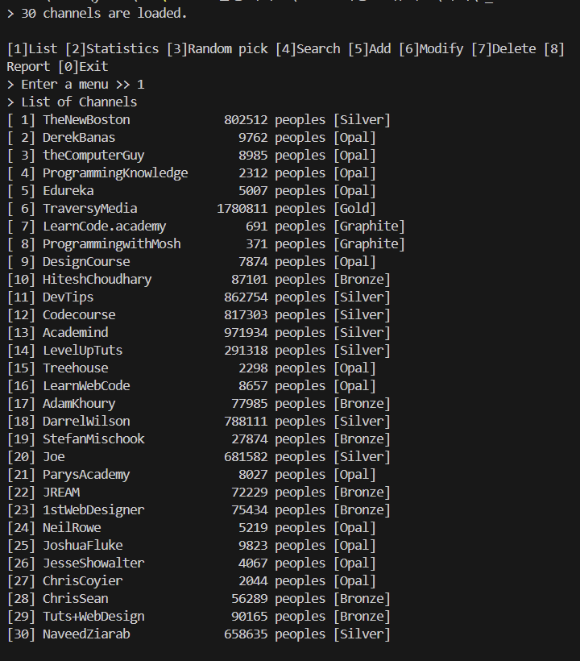
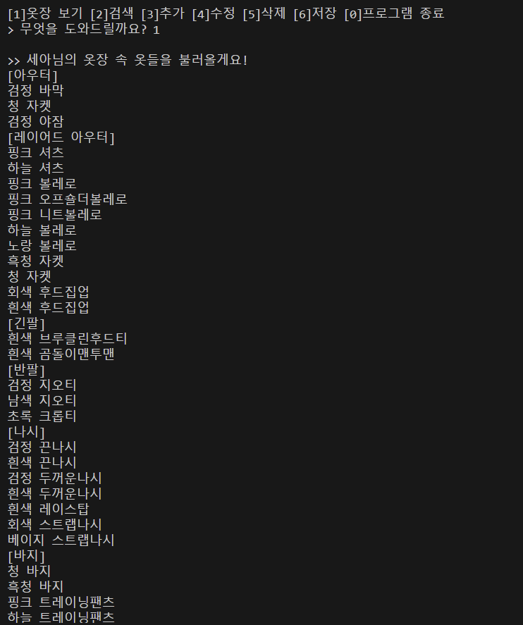

# C Programming Coursework

C 프로그래밍 수업에서 작성한 과제와 실습 코드를 모아둔 저장소입니다. 과제는 랩별로 정리되어 있으며, 기본 문법부터 배열과 파일 입출력, 목록 관리 프로그램까지 연습했습니다.

A collection of assignments and exercises from a C programming course. Work is organized by lab and covers programming fundamentals, arrays, file I/O, and list management programs.

## Labs | 과제 목록

| **Lab 1 — C 기초** | 반복문과 별 출력 패턴, 배열을 이용한 점호 인원 합계·비율 계산 등 기초 콘솔 실습 Loops, star patterns, and array-based attendance and percentage calculation

| **Lab 2 — 과목 목록 관리** | 과목 목록 조회, 추가, 수정, 신청, 저장 실습 View, add, modify, apply for, and save course entries

| **Lab 3 — 채널 관리** | 채널 목록 조회, 통계, 무작위 선택, 검색, 수정, 삭제 및 보고서 저장 List channels, view statistics, pick randomly, search, edit, delete, and save a report

| **Lab 4 — 옷장 관리 시스템** | 옷장 조회, 색상·이름 검색, 옷 추가·수정·삭제, 변경 내용 저장 View and search clothing by color or name; add, edit, delete, and save items

## Result Screenshots | 실행 결과 미리보기

### Lab 2 — 과목 목록 관리

[Lab 2 결과 화면 더 보기](과제/C_lab2/result)

### Lab 3 — 채널 관리

[Lab 3 결과 화면 더 보기](과제/C_lab3/result)

### Lab 4 — 옷장 관리 시스템

[Lab 4 결과 화면 더 보기](과제/C_lab4/result)

## Topics | 학습 내용

- C 기본 문법과 표준 입출력
- 반복문과 배열
- 목록 조회·추가·수정·삭제
- 파일을 이용한 데이터 저장
- 여러 소스 파일과 헤더 파일 구성
- Makefile을 이용한 빌드 구성

- C syntax and standard input/output
- Loops and arrays
- Listing, adding, editing, and deleting records
- Saving data to files
- Organizing source and header files
- Build configuration with a Makefile

## Skils | 기술

- C
- Standard C Library
- File I/O
- Make
